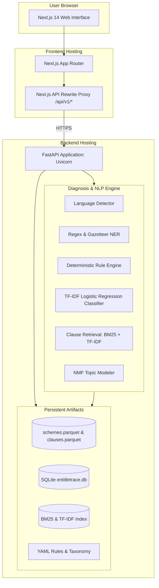
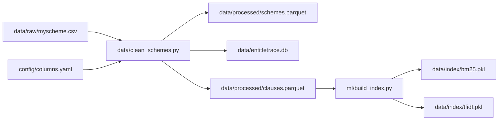
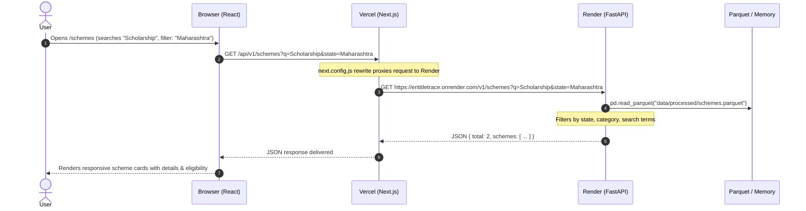
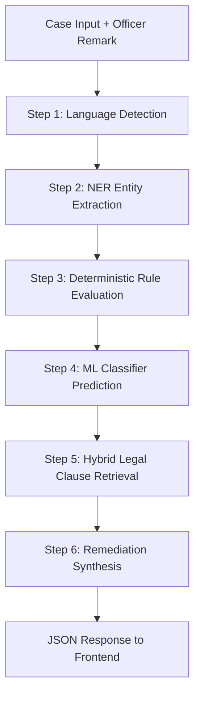
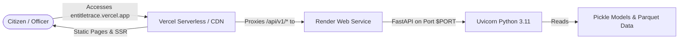

# EntitleTrace: Full System Architecture & Working Guide

## 1. Executive Summary & Purpose

**EntitleTrace** is an explainable AI and diagnosis platform designed to resolve one of the most frustrating barriers in public governance: **welfare scheme application rejections**.

In India, welfare applications (such as scholarships, housing subsidies, and farmer grants) are frequently rejected by scrutiny officers using terse, ambiguous, or multilingual remarks (e.g., *"उत्पन्न मर्यादा जास्त"*, *"Income certificate invalid"*, or *"Domicile not uploaded"*). Citizens often do not understand why they were rejected, which exact policy rule was breached, or what concrete steps they need to take to re-apply successfully.

### What EntitleTrace Does:
1. **Catalog Exploration**: Ingests, indexes, and catalogs central and state government schemes.
2. **Multilingual Rejection Diagnosis**: Analyzes rejection remarks in **English, Hindi, and Marathi**.
3. **Hybrid Diagnostic Pipeline**: Combines deterministic rule engines with machine learning (TF-IDF + Logistic Regression) and Named Entity Recognition (NER).
4. **Legal Clause Retrieval**: Grounds every rejection in actual policy clauses via BM25 Okapi & TF-IDF search.
5. **Actionable Remediation**: Generates localized, step-by-step remedy guidelines for the citizen.

---

## 2. High-Level Architecture Diagram



---

## 3. Data Pipeline: How Schemes Are Ingested, Cleaned & Stored

Before schemes can appear in the app, they pass through a structured ingestion and indexing lifecycle:



### 1. Ingestion (`data/clean_schemes.py`)
- Reads raw scraped/downloaded scheme metadata (`data/raw/myscheme.csv`).
- Standardizes columns using `config/columns.yaml` (name, level, state, ministry, categories, details, benefits, eligibility, required documents).
- Cleans whitespace, normalizes Unicode, strips formatting anomalies.
- Generates unique scheme IDs (`SCH_...`).

### 2. Dual Storage Engine
- **SQLite Database (`data/entitletrace.db`)**: Provides relational query capability and structured schema preservation.
- **Apache Parquet (`data/processed/schemes.parquet` & `clauses.parquet`)**: Ultra-compact columnar storage (~33 KB) enabling lightning-fast read operations without needing an external database server on Render.

### 3. Clause Splitting & BM25 Indexing (`ml/build_index.py`)
- Eligibility requirements, documents, and terms are parsed into atomic clause chunks.
- A **Rank-BM25 Okapi** index and a **TF-IDF sparse matrix** are compiled and saved into `data/index/bm25.pkl` and `tfidf.pkl`.
- This index allows sub-millisecond keyword and semantic search against official legal clauses.

---

## 4. How Schemes Become Visible on the Frontend

When a user visits the **Schemes Explorer** page (`/schemes`), here is the exact request lifecycle:



### Resilient Fallback System:
If Render is experiencing a free-tier cold-start (~30 seconds), `frontend/lib/api.ts` gracefully activates `frontend/lib/fallbackSchemes.ts`. The catalog **never appears empty or broken** to the user while waiting for the remote backend to respond.

---

## 5. The Rejection Diagnosis Engine (`POST /v1/analyze`)

This is the core AI/ML engine of EntitleTrace. When an applicant or officer submits a case with applicant details, uploaded documents, and an officer remark, it executes a 6-step diagnostic pipeline in `backend/app/services/analyze_case.py`.



### Step 1: Language Detection (`backend/app/nlp/lang.py`)
- Analyzes the input remark string.
- First checks Devanagari Unicode code points (`\u0900`–`\u097F`).
- Differentiates Marathi from Hindi using lexical marker tokens (*"आहे"*, *"नाकारला"*, *"झाले"*, *"उत्पन्न दाखला"*).
- Falls back to `langdetect` library. Supports `en`, `hi`, `mr`.

### Step 2: Named Entity Recognition (`backend/app/nlp/ner.py`)
- Uses regex patterns and domain gazetteers tailored for Indian bureaucracy.
- Extracts:
  - **`AMOUNT_INCOME`**: `₹2,50,000`, `1.5 Lakh`, `२,००,०००`
  - **`AGE`**: `21 years`, `वय २५`, `age 19`
  - **`DOCUMENT_TYPE`**: `Income Certificate`, `Caste Certificate`, `उत्पन्न दाखला`, `Non-Creamy Layer`
  - **`DATE`**: Issue dates, validity thresholds (e.g. `2025-04-12`).

### Step 3: Deterministic Rule Engine (`backend/app/rules/engine.py`)
- Reads official criteria rules from `config/demo_schemes.yaml`.
- Performs objective checks:
  - **Income Ceilings** (`numeric_max`): e.g. applicant income ≤ ₹1,50,000.
  - **Age Ranges** (`numeric_range` / `numeric_min`): e.g. 18 to 35 years.
  - **Mandatory Documents** (`documents_present`): Checks if required document types were submitted.
  - **Document Freshness** (`max_age_days`): Ensures income certificates are ≤ 365 days old.
  - **Category / Domicile** (`category_in`, `state_in`): Validates reservations and state residence.

### Step 4: Machine Learning Classifier (`backend/app/nlp/classifier.py`)
- If rules pass or remarks are vague, the ML classifier classifies the remark text into standardized failure categories:
  - `eligibility_income`
  - `expired_or_invalid_document`
  - `missing_document`
  - `eligibility_category_or_residence`
  - `eligibility_age`
- Model: Scikit-learn **TF-IDF Vectorizer (1-2 n-grams) + Logistic Regression (C=1.0)** trained on synthetic bilingual cases (`data/synthetic/cases.jsonl`).
- Returns primary label, secondary labels, and confidence probability.
- If confidence < 0.65, flags `needs_human_review: true`.

### Step 5: Hybrid Legal Clause Retrieval (`backend/app/nlp/retrieval.py`)
- Combines the user's rejection remark with the predicted failure category to form a search query.
- Evaluates scores:
  $$\text{Score} = 0.6 \times \text{BM25Score} + 0.4 \times \text{TFIDFCosineScore}$$
- Retrieves the top matching legal clauses from official policy documents.
- Gives the citizen verifiable proof: *"Your application was rejected based on Clause 4.2 of Government Resolution No. 2023/..."*

### Step 6: Remediation Synthesis (`config/taxonomy.yaml`)
- Matches the failure reason with localized action templates.
- Dynamically injects case details:
  - *"Your parent's annual income of ₹1,80,000 exceeds the maximum allowed limit of ₹1,50,000 under this scheme."*
  - In Marathi: *"तुमचे उत्पन्न मर्यादा १,५०,००० पेक्षा जास्त आहे. कृपया उत्पन्नाचा दाखला तपासा."*

---

## 6. Additional Backend Services

### Document Extraction Service (`POST /v1/extract`)
- Located in `backend/app/ingestion/document_reader.py`.
- Accepts uploaded PDF, DOCX, TXT, or scanned files.
- Uses **PyMuPDF (`fitz`)** for PDF page-by-page extraction and **`python-docx`** for Word files.
- Automatically parses extracted text and feeds it into the diagnosis form.

### Analytics & NMF Topic Modeling (`GET /v1/analytics/*`)
- **Failure Breakdown (`/v1/analytics/failures`)**: Aggregates rejection distribution by failure type, language, and scheme.
- **Topic Clustering (`/v1/analytics/topics`)**: Uses **Non-Negative Matrix Factorization (NMF)** on TF-IDF vectors of past rejection remarks to uncover latent rejection clusters (e.g., recurring issues with non-creamy layer certificates or IFSC code mismatches).

---

## 7. Frontend Architecture (Next.js 14)

The frontend is built with **Next.js 14 (App Router)** and styled using modern, glassmorphic **Tailwind CSS**.

```
frontend/
├── app/
│   ├── layout.tsx         # Global theme, font, and navigation header
│   ├── page.tsx           # Landing hero, problem overview, key metrics
│   ├── schemes/page.tsx   # Searchable scheme catalog with filters
│   ├── schemes/[id]/page  # Scheme deep-dive with legal clauses & rules
│   ├── analyze/page.tsx   # Interactive diagnosis workbench
│   ├── analytics/page.tsx # Charts & NMF topic insights
│   ├── extract/page.tsx   # Standalone file text extractor
│   └── rules/page.tsx     # Visual criteria matrix
├── context/
│   └── LanguageContext    # Trilingual state management (EN / HI / MR)
├── lib/
│   ├── api.ts             # Strongly typed API client
│   └── fallbackSchemes.ts # Offline dataset fallback
└── next.config.js         # API rewrites & CORS proxy
```

### Trilingual Support (`LanguageContext.tsx`)
- Provides real-time switching between **English (English)**, **हिंदी (Hindi)**, and **मराठी (Marathi)**.
- Localizes navigation labels, form inputs, error messages, and explanations without reloading the page.

---

## 8. Deployment Architecture (Vercel + Render)



### Why this setup is optimal:
1. **Zero CORS Issues**: The browser only communicates with Vercel (`/api/v1/...`). Next.js rewrites on Vercel proxy requests server-to-server to Render.
2. **Cost-Effective**: Both Vercel and Render run on free tiers.
3. **Optimized Runtimes**: Next.js runs on global edge/serverless infrastructure for instant page loads; heavy Python ML and NLP libraries (`scikit-learn`, `pandas`, `rank-bm25`, `pymupdf`) run on Render's native Python Linux container.

---

## 9. Summary of Key Files

| File Path | Role |
| :--- | :--- |
| `backend/app/main.py` | FastAPI application entry point, CORS, and router registration |
| `backend/app/api/schemes.py` | Scheme listing, filtering, and detail endpoints |
| `backend/app/api/analyze.py` | Case diagnosis and rejection explanation endpoint |
| `backend/app/services/analyze_case.py` | 6-stage diagnostic pipeline orchestrator |
| `backend/app/rules/engine.py` | Deterministic eligibility rule evaluator |
| `backend/app/nlp/classifier.py` | TF-IDF + Logistic Regression rejection classifier |
| `backend/app/nlp/retrieval.py` | BM25 + TF-IDF hybrid legal clause search |
| `backend/app/nlp/ner.py` | Multilingual regex and gazetteer entity extractor |
| `backend/app/nlp/lang.py` | Script-based and statistical language detector (en/hi/mr) |
| `data/clean_schemes.py` | Data normalization and Parquet/SQLite generation |
| `ml/build_index.py` | Legal clause indexer (BM25 + TF-IDF) |
| `frontend/lib/api.ts` | Typed frontend API client with offline resiliency |
| `frontend/next.config.js` | Reverse proxy routing Vercel calls to Render |
